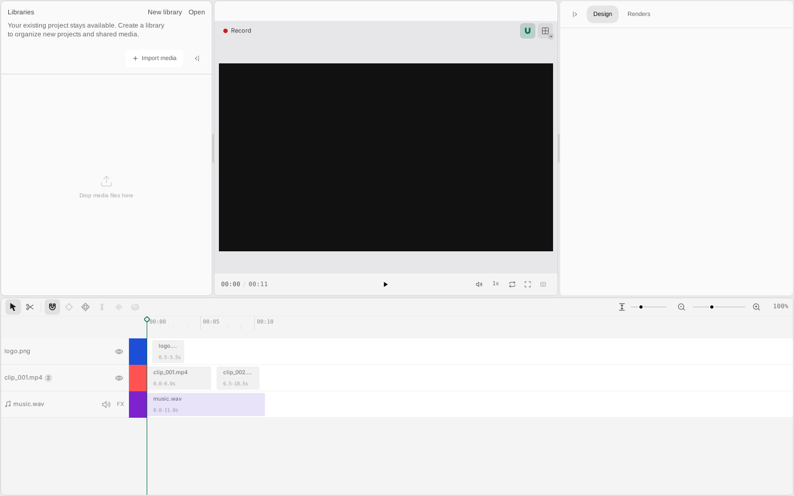

# oneTake: MpVFX

MpVFX is a native video editor for macOS, Linux and Windows, written in Swift: cut, grade and export video with a
custom-drawn timeline, colour grading on the GPU and its own media engine (no FFmpeg). A project is a folder holding
one JSON document, `.studio/project.json`.

**Open core.** The app in this repository is open source under MIT OR Apache-2.0. The media engine and the keyframe
engine it runs on are proprietary: they are not in this repository, and the app downloads them as prebuilt,
checksum-pinned libraries ([`binaries.lock`](mpvfx-swift/binaries.lock),
[`scripts/fetch-binaries.py`](mpvfx-swift/scripts/fetch-binaries.py)) and calls them through its own Swift adapters,
[`Sources/OneTakeMedia`](mpvfx-swift/Sources/OneTakeMedia) and
[`Sources/OneTakeKeyframes`](mpvfx-swift/Sources/OneTakeKeyframes).
See [LICENSE](LICENSE).

<p align="center"></p>

<p align="center"><em>Linux shell, <code>MPVFX_DEMO=1</code>, 1440×900 at DPR 1, captured by <a href="mpvfx-swift/scripts/capture-readme.sh"><code>scripts/capture-readme.sh</code></a>. The demo document names media files that do not exist, so the preview shows an empty frame.</em></p>

## What it does now

- **Editor:** the Linux shell (GTK 3 + Cairo) and the macOS shell (AppKit + Core Graphics) run the same
  custom-drawn editor: library, media bin, preview, timeline and inspector.
- **Editing:** timeline editing, keyframes on position, crop and other parameters, colour grading and stylize
  effects, text layers and 3D transforms. The preview and the export draw with the same painter.
- **Composition size:** with nothing selected, the Design tab sets the project's frame: Landscape 16:9, Portrait 9:16,
  Square 1:1, Vertical 4:5, 4K 16:9 or a custom width and height. Untouched clips refit; placed clips and text keep
  their size and place relative to the centre. The Renders tab's output size scales the composition and keeps its
  shape (720p of a 9:16 project renders 720×1280).
- **GPU grading:** the colour grade and stylize effects run on the GPU through Metal (macOS), Vulkan (Linux) or
  Direct3D 11 (Windows), and on the CPU when the machine has no usable device. `MPVFX_GPU=0` forces the CPU;
  `MPVFX_GPU=software` also accepts a software device (Mesa lavapipe, WARP). `swift run -c release MpvfxColorBench`
  times CPU against GPU at 1080p and 4K. The Vulkan and Direct3D kernels are generated from the Metal ones by
  [`scripts/gpu/gen-compute-shaders.py`](mpvfx-swift/scripts/gpu/gen-compute-shaders.py) (needs glslang-tools and
  spirv-tools).
- **Audio:** playback through PulseAudio (Linux) or Core Audio (macOS), with a bus/FX graph that playback and export
  share.
- **Media:** import, probing, thumbnails, filmstrips, waveforms, silence detection, preview decoding, live audio and
  export all go through [`Sources/OneTakeMedia`](mpvfx-swift/Sources/OneTakeMedia), the app's Swift adapter over the
  engine's C interface.
- **Projects:** saving (Cmd/Ctrl+S, close, autosave), media import, the library navigator and exports from the
  Renders tab run through `RuntimeDesktopBackend`. Publishing is not part of the app.
- **Older projects:** every project document opens, previews and exports. A missing or older `"mediaEngine"` value
  is read as the native timeline and the next save writes `"native"`. Layers from an earlier version of the editor
  that the renderer cannot draw stay in the project unchanged, are skipped in preview and export, and are named in
  one notice when the project opens.

[`docs/STATUS.md`](mpvfx-swift/docs/STATUS.md) lists the state of every feature.

## Media formats

The media engine decides what each format supports; the app's list is
`mpvfx-swift/Sources/MpvfxRuntime/Media/ImportFormats.swift`.

- **Import:** MP4/M4V/MOV with H.264 video (8-bit 4:2:0) or HEVC video (Main and Main 10, 4:2:0, such as iPhone
  `.mov` clips) and LPCM, FLAC, AAC (AAC-LC, HE-AAC, HE-AAC v2) or MP2 sound; WAV, FLAC, M4A, ADTS `.aac` and MPEG
  audio Layer I/II (`.mp2`) files; PNG, JPEG and BMP images. Any other format is refused with a message that names
  it. HEVC and MP2 decode inside the media engine.
- **MP3 sound:** a file with MP3 (Layer III) sound imports without sound, and `.mp3` files are
  refused (not decided yet).
- **Export:**
  - MP4: H.264 video with FLAC sound, 48 kHz stereo 16-bit.
  - MOV with alpha: PNG frames (RGBA 8-bit) with 16-bit LPCM sound, 48 kHz stereo.
  - An export never replaces a file: if one appears at the output path while it renders, the export stops with a
    message and that file is left as it was.

## Build and run

Requirements: Swift 6.0 or newer and Python 3.11 or newer (for the engine download script).

- macOS 15 or newer: Xcode (SQLite and Core Audio come with the system).
- Linux: `libgtk-3-dev`, `libsqlite3-dev`, `pkg-config`; `libpulse-dev` for audio output.
- Windows 10 or 11: the Swift toolchain; put `mpvfx-swift\.binaries\media\bin` and `mpvfx-swift\.binaries\keyframes\bin`
  on `PATH` before `swift run` or `swift test`.

```sh
cd mpvfx-swift
python3 scripts/fetch-binaries.py   # engine libraries into .binaries/ (again after binaries.lock changes)
swift build
swift run MpVFX                     # the standalone project (made on first launch)
MPVFX_DEMO=1 swift run MpVFX        # the built-in demo timeline
MPVFX_PROJECT=/path/to/project swift run MpVFX
```

`fetch-binaries.py` stops with a clear message when the pinned engine release is not published yet or a download does
not match its checksum. If `swift build` reports "Could not find Package.swift", the shell is not in `mpvfx-swift/`;
if it cannot find `mpvfx_media.h` or `cvkf.h`, or the link step misses `mpvfx_media` or `cvkf`, run
`python3 scripts/fetch-binaries.py` first. `MPVFX_PROJECT` takes a project folder or its `.studio/project.json`.

**Status:** the media engine is pinned at 0.1.0 and the keyframe engine at 1.0.0 in `mpvfx-swift/binaries.lock`.

Installers (macOS disk image, Windows setup.exe, Ubuntu/Debian .deb) are built by CI and published as releases; how
to get, build and sign them: [`docs/PACKAGING.md`](mpvfx-swift/docs/PACKAGING.md).

## Test and check

From `mpvfx-swift/`, before every push:

```sh
sh scripts/check.sh          # engine libraries, fetch-script tests, copyright blocks, shaders, swift build, swift test
sh scripts/check.sh --fast   # the same without swift build and swift test
swift test                   # the whole suite
sh scripts/doctor.sh         # what a full run needs that is missing, with fixes
```

A full run first runs [`scripts/doctor.sh`](mpvfx-swift/scripts/doctor.sh); with a prerequisite missing (Python 3,
Swift, on Linux the GTK and SQLite dev packages, or a Vulkan driver when the Vulkan headers are installed) it stops
at once with `check: UNAVAILABLE` and exit code 2, which is neither passed nor failed.

CI ([`.github/workflows/mpvfx-ci.yml`](.github/workflows/mpvfx-ci.yml)) builds, tests and packages the app on Linux,
Windows and macOS with the engine libraries pinned in [`binaries.lock`](mpvfx-swift/binaries.lock); `ci-ok` is the
required check. [`strip-check.yml`](.github/workflows/strip-check.yml) then verifies that every published binary is stripped
([`docs/PACKAGING.md`](mpvfx-swift/docs/PACKAGING.md), "Symbols"). Contributions are welcome: [CONTRIBUTING.md](CONTRIBUTING.md).

## Repository layout

| Path | What it holds |
| --- | --- |
| [`mpvfx-swift/`](mpvfx-swift/) | the app's Swift package: sources, tests, docs, scripts, installers |
| [`mpvfx-swift/Sources/MpvfxDesktop`](mpvfx-swift/Sources/MpvfxDesktop) | the app: shells, editor session, wiring of every module (`main.swift`) |
| [`mpvfx-swift/Sources/MpvfxRuntime`](mpvfx-swift/Sources/MpvfxRuntime) | projects, libraries, import, probing, export pipeline (no UI) |
| [`mpvfx-swift/Sources/MpvfxPlayer`](mpvfx-swift/Sources/MpvfxPlayer) | preview compositor, decode lanes, the painter preview and export share |
| [`Sources/MpvfxColor`](mpvfx-swift/Sources/MpvfxColor), [`Sources/CMpvfxVulkan`](mpvfx-swift/Sources/CMpvfxVulkan), [`scripts/gpu`](mpvfx-swift/scripts/gpu) | colour grade: CPU reference shader, renderer choice, Vulkan compute host, shader generator |
| [`Sources/MpvfxAudio`](mpvfx-swift/Sources/MpvfxAudio), [`Sources/MpvfxAudioGraph`](mpvfx-swift/Sources/MpvfxAudioGraph) | live audio, stem decoding, bus/FX graph, offline mix |
| [`Sources/MpvfxTimeline`](mpvfx-swift/Sources/MpvfxTimeline), [`Sources/MpvfxPanels`](mpvfx-swift/Sources/MpvfxPanels), [`Sources/MpvfxCanvas`](mpvfx-swift/Sources/MpvfxCanvas) | timeline, inspector and side panels, drawing abstraction |
| [`mpvfx-swift/Sources/MpvfxShared`](mpvfx-swift/Sources/MpvfxShared) | document schema, validation, export policy, shared types |
| [`mpvfx-swift/docs/`](mpvfx-swift/docs/) | [`STATUS.md`](mpvfx-swift/docs/STATUS.md), [`FEATURES.md`](mpvfx-swift/docs/FEATURES.md), [`MEMORY.md`](mpvfx-swift/docs/MEMORY.md), [`PACKAGING.md`](mpvfx-swift/docs/PACKAGING.md) |
| [`mpvfx-swift/scripts/`](mpvfx-swift/scripts/) | [`check.sh`](mpvfx-swift/scripts/check.sh), [`doctor.sh`](mpvfx-swift/scripts/doctor.sh), [`fetch-binaries.py`](mpvfx-swift/scripts/fetch-binaries.py), [`capture-readme.sh`](mpvfx-swift/scripts/capture-readme.sh) |
| [`mpvfx-swift/binaries.lock`](mpvfx-swift/binaries.lock) | engine versions, download URLs and SHA-256 per platform |
| [`.github/`](.github/) | CI: build, test, package and publish on all three platforms |

## Status and limitations

Measured at this revision:
- **Platforms:** Linux is built and tested here. macOS is built and tested in CI and has had little hands-on use.
  The Windows port (Win32 shell, Direct2D canvas, WASAPI, Win32 filesystem layer) is built and tested in CI and has
  had little hands-on use.
- **Formats:** files in any format the import list above does not name are refused with a message. AAC is
  decoded, not encoded: exports carry FLAC or LPCM sound.
- **HEVC speed:** HEVC decodes on one thread, about 33 fps at 1080p and 10 fps at 4K, so 4K phone clips do not
  preview in real time.
- **HDR:** export is SDR only. A project whose media the probe marks HDR (PQ or HLG transfer, or BT.2020 primaries)
  is refused at export with a message; it still imports and previews.

## Copyright

Copyright 2026 Arshiya Rahgozar. Dual licensed under the MIT license or the Apache License, Version 2.0, at your
option ([`LICENSE-MIT`](LICENSE-MIT), [`LICENSE-APACHE`](LICENSE-APACHE)); it continues the Apache-2.0
[mpvfx](https://github.com/marshiyar/mpvfx). The media and keyframe engines it links are proprietary
([`LICENSE`](LICENSE)).
