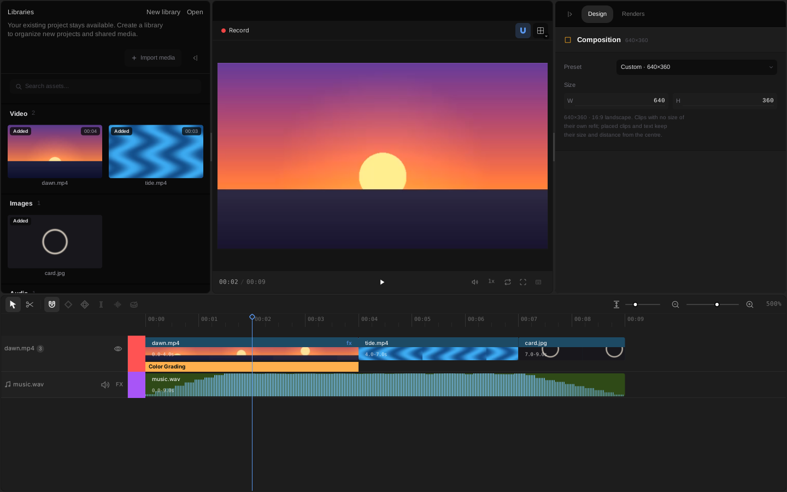
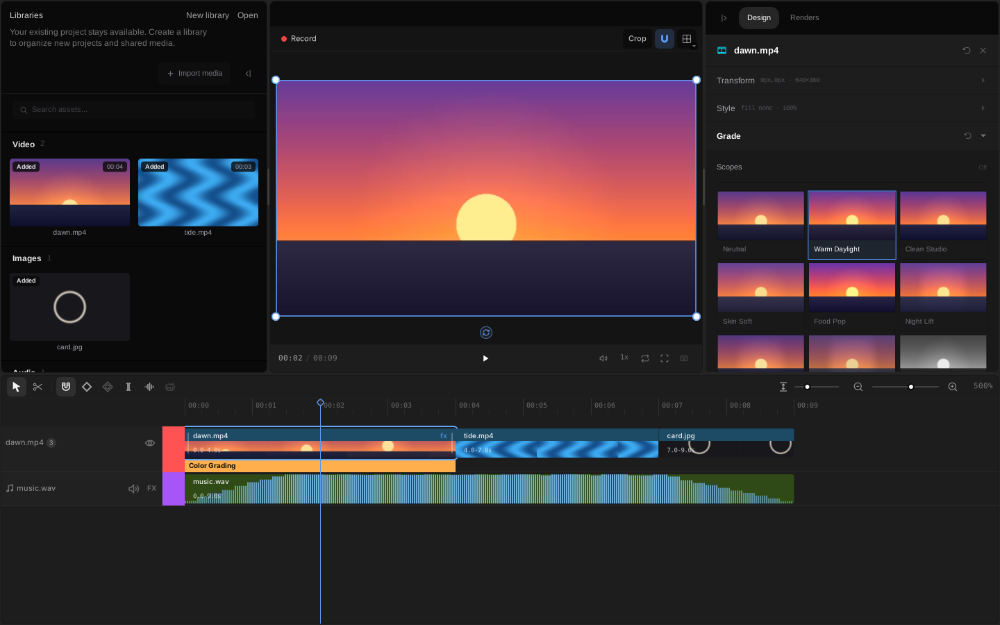
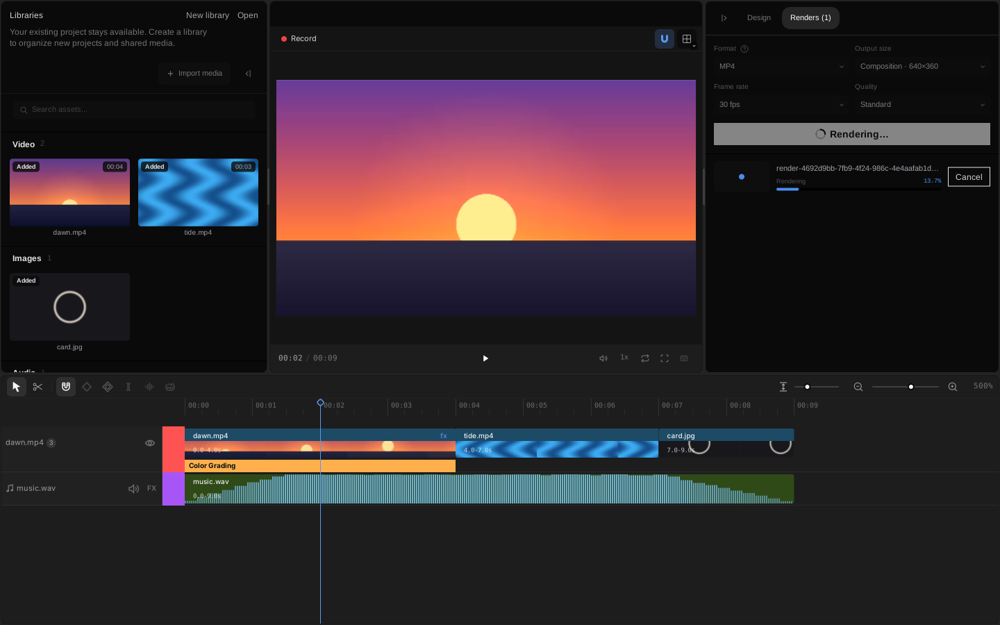

# Getting started

This page takes you from installing MpVFX to an exported MP4: open the sample project, import a file, cut, grade and
export. Every step is something the app does today; [`STATUS.md`](STATUS.md) lists what is partial or missing.

The pictures are the Linux app at 1440×900 on the sample project, taken with
[`scripts/capture-getting-started.sh`](../scripts/capture-getting-started.sh). macOS and Windows draw the same editor.
Shortcuts are written for Linux and Windows: on macOS use Cmd where it says Ctrl.

## 1. Install

Download the installer for your system from [the website](https://marshiyar.github.io/onetake-site/) or the
[releases page](https://github.com/marshiyar/oneTake/releases):

| System | File | After installing |
| --- | --- | --- |
| macOS 15 or newer, Apple silicon | disk image | drag MpVFX to Applications |
| Windows 10 or 11, x64 | `setup.exe`, or the portable zip | MpVFX in the Start menu (installed per user in `%LOCALAPPDATA%\Programs\MpVFX`); the zip runs where you unpack it |
| Ubuntu 24.04 or newer, Debian 13 | `.deb`, or the archive | MpVFX in the applications menu, `mpvfx` on the command line |

The Windows installer is not code-signed yet (SmartScreen asks for **More info**, then **Run anyway**); the Linux
package is unsigned, and the macOS disk image is Developer ID signed and notarized when the signing secrets are set
(see [`PACKAGING.md`](PACKAGING.md)). To build from source instead, follow
[Build from source](../../README.md#build-from-source).

The first launch creates your own project, called MpVFX, and opens it. It lives in `.config/MpVFX/projects/MpVFX` in
your home folder, on every system (`$XDG_CONFIG_HOME/MpVFX` when that variable is set; `MPVFX_USER_DATA_DIR` moves the
whole `MpVFX` folder elsewhere).

## 2. Open the sample project

A project is a folder: `.studio/project.json` holds the timeline, and the media files sit next to it. The sample,
[`samples/getting-started`](../samples/getting-started), is 9 seconds at 640×360 and 30 fps: two video clips, an end
card and a music track, with a warm grade on the first clip. Its pictures and sound are drawn by code in this
repository, so you can use it freely.

1. Download the repository (the green Code button on GitHub, then Download ZIP) and unpack it.
2. Copy `mpvfx-swift/samples/getting-started` somewhere of your own, for example your home folder. The app saves your
   edits into the folder it opens, so work on a copy. The `.studio` folder is hidden in most file managers; copy the
   whole `getting-started` folder and it comes along.
3. Open that copy in MpVFX. On macOS use **File > Open…** (Cmd+O); on every system the Media panel's **…** menu has
   **Open project…**, and **File > Open Recent** (macOS) reopens a project you opened before. Pick the
   `getting-started` folder (the one holding `.studio/project.json`); the app saves the project you had open first,
   and a folder that is not a project is reported while your open project stays. From a terminal,
   `MPVFX_PROJECT` opens a project at launch instead:

   ```sh
   # Linux
   MPVFX_PROJECT="$HOME/getting-started" mpvfx
   # macOS
   MPVFX_PROJECT="$HOME/getting-started" /Applications/MpVFX.app/Contents/MacOS/MpVFX
   ```

   ```powershell
   # Windows (PowerShell)
   $env:MPVFX_PROJECT = "$HOME\getting-started"; & "$env:LOCALAPPDATA\Programs\MpVFX\MpVFX.exe"
   ```

   From a source checkout: `MPVFX_PROJECT=samples/getting-started swift run MpVFX` in `mpvfx-swift/` (this edits the
   checked-in sample; copy it first if you want to keep it unchanged).



The window has four parts. On the left, the media bin lists the project's files by kind. In the middle, the preview
plays the timeline: Space plays and pauses, J, K and L play backward, stop and play forward, and the arrow keys step one
frame (Shift: ten). On the right, the Design tab shows the composition size, or the selected clip's settings, and the
Renders tab exports. Below is the timeline, with one row per track.

Without `MPVFX_PROJECT` the app opens your own MpVFX project again. The steps below work the same there.

## 3. Import media

Click **Import** at the top of the media bin (or **Import media…** in its **…** menu), or press Ctrl+I, and pick
files; or drag files from your file manager onto the window. Each file is copied into the project folder, checked,
and listed in the bin. Dropped on the timeline's tracks, the files are also placed on the timeline from the drop
point on. The bin's search and filter menu (kind, timeline use, order) narrow the list, and that choice is kept
between launches.

To put a bin file on the timeline, drag its card onto a track (it lands at the pointer) or onto the preview (it lands
at the playhead), double-click the card, or choose **Add to timeline** from the card's menu.

The app imports MP4, M4V and MOV video (H.264, or HEVC as phones record it); WAV, FLAC, M4A, `.aac`, `.mp2`, Ogg Vorbis
and some Opus sound; and PNG, JPEG and BMP pictures. The exact list is under [Media formats](../../README.md#media-formats).
A file it cannot read is refused with a message that names the format. MP3 is not supported yet.

## 4. Cut


- **Split:** put the playhead where you want the cut and press S. With clips selected, S splits those; with nothing
  selected, it splits every clip under the playhead. The razor tool (B, or the scissors in the timeline toolbar) splits
  the clip you click; Shift+click splits every track at that point. V goes back to the select tool.
- **Trim:** drag either end of a clip. Hold Alt (Option on macOS) while you drag to ripple the trim: the clips after it
  on the same track follow the edge.
- **Move:** drag a clip along its track or onto another one. N turns snapping to clip edges and the playhead on and off.
- **Delete:** select a clip and press Delete. Shift+Delete closes the gap it leaves (ripple delete).
- **Undo:** Ctrl+Z undoes, Ctrl+Shift+Z redoes. The history is kept when you quit and comes back when you reopen the
  project.

Try it on the sample: click the dawn clip to select it, put the playhead at 2 seconds and press S. Select the second
half and press Delete; then press Ctrl+Z and use Shift+Delete instead, and the tide clip moves up behind the first half.

## 5. Grade



Select a video clip or a picture on the timeline and open **Grade** on the Design tab. The group has, top to bottom:

- **Scopes:** waveform, RGB parade, vectorscope, histogram and false colour of the selected clip's graded frame or
  of the composited program (the row's Clip / Program switch); the dockable Scopes panel (Window / Panels) shows the
  same program scopes beside the preview.
- **Presets:** looks such as Warm Daylight, Clean Studio and Mono Clean, each shown on a frame of the clip. **Amount**
  sets how strongly the grade applies.
- **Primary:** exposure, contrast, highlights, shadows, whites, blacks, temperature, tint, vibrance and saturation.
- **Color wheels** for shadows, midtones and highlights, and **Curves** (master, R, G, B, hue against hue, saturation and
  luma).
- **Secondary color:** pick a hue range and shift its hue, saturation, luma, warmth and tint.
- **Custom LUT:** import a `.cube` file with + and apply it.
- **Finish:** vignette and grain, each with its own settings behind the gear.
- **Copy grade to:** the same grade on the other clips of this file, or on all the project's media.
- **Auto balance** sets exposure, warmth and tint from the frame's statistics, and **Match look** fits the grade to
  another clip you pick as a reference; both are one undo step and stay editable. **Saved looks** stores a grade
  under a name so you can apply it to other clips later.

The first clip of the sample uses Warm Daylight. Select the tide clip and pick a preset of your own; the preview shows
the change at once. Preview and export draw with the same painter, so the export looks like the preview. The grade runs on the GPU (Metal on macOS,
Vulkan on Linux, Direct3D 11 on Windows) and on the CPU when there is no usable device. Every change is one undo step.

## 6. Export



Open the **Renders** tab and choose:

- **Format:** MP4 (H.264 video, FLAC sound) for general use, or MOV (PNG frames with transparency, 16-bit PCM sound; very
  large files).
- **Output size:** the composition size, or that size scaled with its shape kept.
- **Frame rate:** 24, 30 or 60 fps. **Quality:** Draft, Standard or High Quality (MP4 only).

Press **Export**. The render appears in the list below with its progress and a Cancel button; the project is saved
before it starts. A finished render's download button opens the folder that holds it: for your own project and for a
project opened with `MPVFX_PROJECT` that is `.config/MpVFX/renders` in your home folder, for a library project the library's output
folder. An export never replaces a file that is already there, and a project with HDR media is refused at export
(export is SDR only).

## 7. Your own project

Your own project, MpVFX, opens whenever you start the app without `MPVFX_PROJECT`. Edits save a moment after you make
them, and Ctrl+S saves at once. To keep several projects apart, create a library with **New library** in the **…** menu at the top of
the Media panel: a library holds events and projects. The switcher beside it (library ▸ event) picks the event, and the
**…** menu switches between projects and back to your own project.

The composition is 1920×1080 in a new project. To change it, press Esc in the timeline so nothing is selected, then pick a preset (16:9, 9:16, 1:1, 4:5, 4K) or type a width and height on the Design tab.

A few more things worth trying on the sample: press M in the timeline to drop a sequence marker and open the
Markers panel from Window / Panels to jump between markers; open the Mixer from Window / Panels to ride the music
track's gain and pan; add a background from the Media panel menu (Solid colour, Linear gradient, Radial gradient)
and edit it under Design > Background; and drag a text look from the Media sidebar onto the timeline for a title.

## Where to go next

- [`STATUS.md`](STATUS.md): every feature and how complete it is.
- [`FEATURES.md`](FEATURES.md): the full inventory, including what is partial, missing or dropped on purpose.
- [`EFFECTS.md`](EFFECTS.md): the grade and stylize effects in detail.
- [`TIMELINE.md`](TIMELINE.md): zoom, track height, the ruler and the sequence end.
- The keyboard button under the preview lists the shortcuts, with undo and redo.
- [Known limits](../../README.md#known-limits) in the README: what is slow or missing today.
